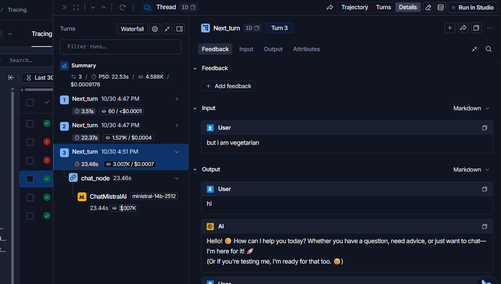
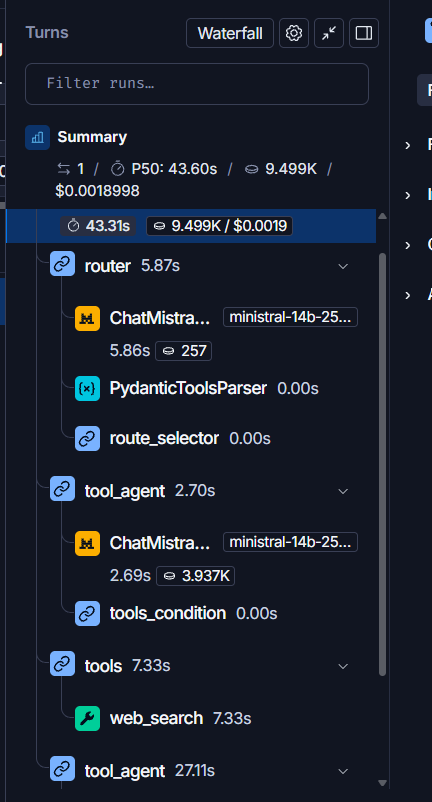
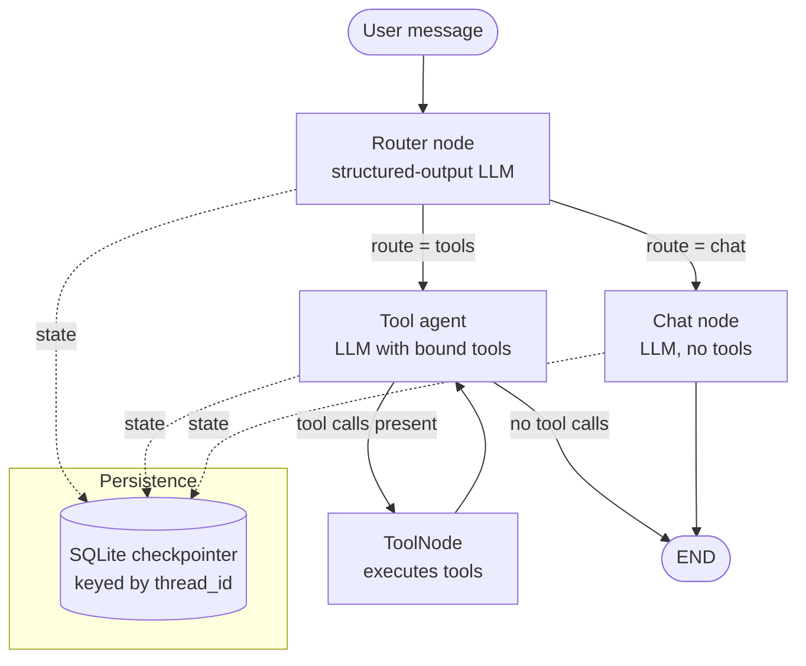

<div align="center">

# Multi-Tool Conversational AI Agent

**A routed, tool-augmented LLM agent built on LangGraph and Mistral AI, with persistent memory, streaming responses and LangSmith observability.**


</div>

---

## Overview

This project is a conversational agent that decides *how* to answer each message rather than sending everything through a single tool-calling loop. A lightweight **intent router** classifies every turn as either a direct chat response or a tool-assisted one. Conversation state is checkpointed per thread, so sessions are resumable, and every run is traced for debugging and cost/latency analysis.

> **Status:** Core agent, routing, tooling, persistence, streaming and tracing are implemented. RAG, automated evaluation and deployment are in active development (see [Roadmap](#roadmap)).


### LangSmith trace





*A single turn traced end to end: router, tool agent, tool execution and final answer, with latency and token usage per step.*

## Table of Contents

- [Screenshots](#screenshots)
- [Key Features](#key-features)
- [Architecture](#architecture)
- [Design Decisions](#design-decisions)
- [Tool Catalog](#tool-catalog)
- [Tech Stack](#tech-stack)
- [Project Structure](#project-structure)
- [Getting Started](#getting-started)
- [Configuration](#configuration)
- [Observability](#observability)
- [Known Limitations](#known-limitations)
- [Roadmap](#roadmap)

## Key Features

| Capability | Description |
|---|---|
| **Intent routing** | Structured-output (Pydantic) router sends each turn to a plain chat path or a tool-calling path, avoiding unnecessary tool-enabled calls on simple queries. |
| **Deterministic overrides** | Messages containing URLs bypass the LLM router and go straight to the tool path. |
| **Fail-safe behavior** | If router inference fails, the system defaults to the tool agent, which can still answer normally. |
| **Tool-calling loop** | Agent ↔ `ToolNode` cycle runs until the model returns a final answer with no pending tool calls. |
| **Persistent memory** | Per-thread checkpointing via LangGraph `SqliteSaver`; prior threads can be listed and resumed. |
| **Streaming** | Responses are streamed to the UI for low perceived latency. |
| **Tracing** | End-to-end LangSmith traces covering router decisions, tool calls, latency and token usage. |

## Architecture



### Graph state

```python
class ChatState(TypedDict):
    messages: Annotated[list[BaseMessage], add_messages]   # reducer appends messages
    route: Literal["tools", "chat"]                        # router decision for the current turn
```

### Request lifecycle

1. **Route.** If the latest message contains `http://` or `https://`, route to `tools`. Otherwise the router LLM receives the last three user messages (truncated) plus the latest message and returns a typed `RouterState(route=...)`.
2. **Execute.** `chat` → single LLM call. `tools` → agent call with bound tools; `tools_condition` loops through `ToolNode` until no further tool calls are requested.
3. **Persist.** The checkpointer writes state per step under the conversation's `thread_id`.
4. **Trace.** The full run is recorded in LangSmith.

## Design Decisions

| Decision | Rationale | Trade-off |
|---|---|---|
| **Separate router instead of always binding tools** | Many turns (greetings, explanations, coding help) need no tools. Routing them to a tool-free path is intended to reduce prompt size and avoid spurious tool calls (not yet measured). | One extra LLM call per turn; routing errors can misdirect a query. |
| **Structured output for routing** | A Pydantic schema constrains the decision to a closed set (`chat` / `tools`), making the router easy to validate and test. | Depends on the model's structured-output reliability. |
| **Router fails open to `tools`** | The tool agent is a superset: it can answer directly or call tools, so a router failure degrades gracefully instead of erroring. | Failures cost more tokens than the chat path would have. |
| **Deterministic URL rule** | Links almost always require fetching content; a rule is cheaper and more predictable than asking an LLM. | Pasted URLs that need no tool still take the tool path. |
| **`temperature=0`** | Stable routing and tool-argument generation. | Less varied phrasing in free-form answers. |
| **SQLite checkpointer** | Zero-infrastructure persistence that is sufficient for local and single-user use. | Not designed for concurrent multi-user production; Postgres is the natural upgrade path. |

## Tool Catalog

The router is prompted to send requests in these categories to the tool agent:

| Category | Examples |
|---|---|
| Live information | News, recent events, "latest" / "today" queries |
| Finance | Currency rates, stock news |
| Environment | Weather, date and time |
| Computation | Exact maths, unit conversion |
| Knowledge | Wikipedia lookup, research papers |
| Web content | Link and YouTube content |
| Language | Translation |
| Productivity | To-dos and reminders, sending email |
| Data files | CSV / Excel handling |

Tool implementations live in `chatbot_tools.py`.

## Tech Stack

| Layer | Technology |
|---|---|
| Orchestration | LangGraph (`StateGraph`, `ToolNode`, `SqliteSaver`) |
| LLM | Mistral AI via `langchain-mistralai` (`ministral-14b-2512`) |
| Schema validation | Pydantic |
| UI | Streamlit |
| Persistence | SQLite |
| Observability | LangSmith |
| Config | python-dotenv |

## Project Structure

```
.
├── chatbot_backend.py     # Graph definition: router, chat node, tool agent, checkpointer
├── chatbot_tools.py       # Tool implementations bound to the agent
├── chatbot_frontend.py    # Streamlit UI with streaming and thread management
├── assets/
│   ├── chat-ui.png          # Chat interface screenshot
│   └── langsmith-trace.png  # Example LangSmith trace
├── basic_chatbot.py       # Simpler baseline version
├── requirements.txt
└── .env.example           # Template for required environment variables
```

## Getting Started

**Prerequisites:** Python 3.10+, a [Mistral API key](https://console.mistral.ai/), and optionally a [LangSmith](https://smith.langchain.com/) account.

```bash
# 1. Clone
git clone https://github.com/Ankitkumar1141/ChatBot.git
cd ChatBot

# 2. Create and activate a virtual environment
python -m venv venv
source venv/bin/activate          # Windows: venv\Scripts\activate

# 3. Install dependencies
pip install -r requirements.txt

# 4. Configure environment
cp .env.example .env              # then fill in your keys

# 5. Run
streamlit run chatbot_frontend.py
```

## Configuration

| Variable | Required | Description |
|---|---|---|
| `MISTRAL_API_KEY` | Yes | Mistral AI API key. The backend raises an error at startup if it is missing. |
| `LANGSMITH_TRACING` | No | Set to `true` to enable tracing. |
| `LANGSMITH_API_KEY` | No | LangSmith API key. |
| `LANGSMITH_PROJECT` | No | Project name under which traces are grouped. |
| `LANGSMITH_ENDPOINT` | No | LangSmith API endpoint. Defaults to `https://api.smith.langchain.com`; use `https://eu.api.smith.langchain.com` for EU workspaces. |

Individual tools may require additional credentials (e.g., email); see `chatbot_tools.py`.

## Observability

With tracing enabled, each conversation turn produces a LangSmith trace showing:

- the router's decision and the input it saw
- every LLM call, tool invocation and tool result in order
- latency and token usage per step

This makes it straightforward to diagnose misrouted queries, malformed tool arguments and slow tool calls.

See the [example trace](#langsmith-trace) above.

## Known Limitations

- **Router quality is unmeasured.** Routing accuracy has not yet been benchmarked on a labeled set (planned below).
- **Limited routing context.** The router sees only the last three user messages, truncated, so long-range follow-ups may be misclassified.
- **No confirmation on side-effect tools.** Actions such as sending email currently execute without a human approval step.
- **Single-node persistence.** SQLite is appropriate for local use, not for concurrent multi-user deployment.
- **No automated tests or CI yet.**

## Roadmap

**Completed**
- [x] LangGraph agent with LLM-based intent router
- [x] Multi-tool calling loop
- [x] Persistent multi-thread memory (SQLite)
- [x] Response streaming
- [x] LangSmith tracing

**In progress / planned**
- [ ] **RAG pipeline:** document ingestion, chunking, embeddings, vector store, retrieval exposed as a graph tool, with source citations
- [ ] **Evaluation suite:** labeled set for router accuracy, tool-call success rate and RAG answer quality (e.g., RAGAS or LLM-as-judge)
- [ ] **Human-in-the-loop approval** for side-effect tools using LangGraph interrupts
- [ ] **Tests and CI:** unit tests for tools and routing logic, GitHub Actions workflow
- [ ] **Containerization and deployment:** Dockerfile and a hosted demo
- [ ] **Persistence upgrade:** Postgres checkpointer for multi-user scenarios

## Author

**Ankit Kumar** · [GitHub](https://github.com/Ankitkumar1141)
